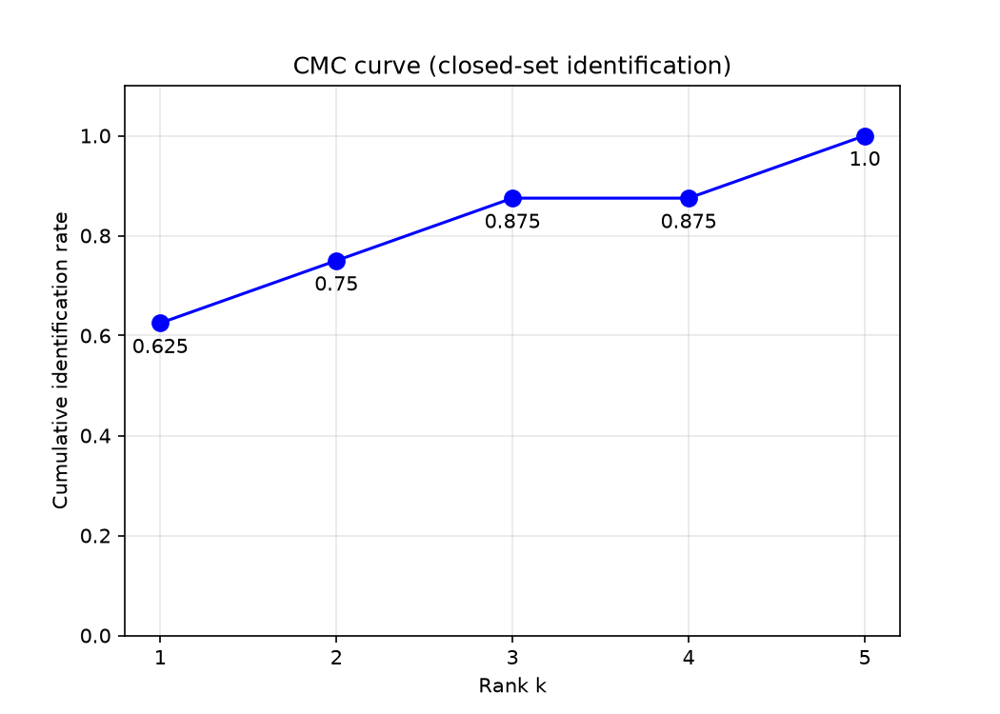
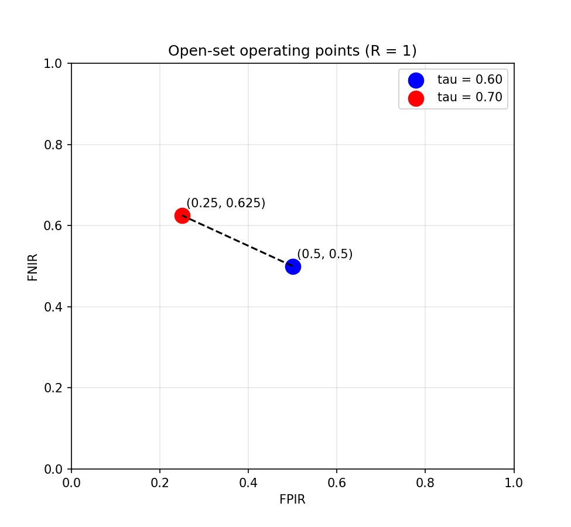
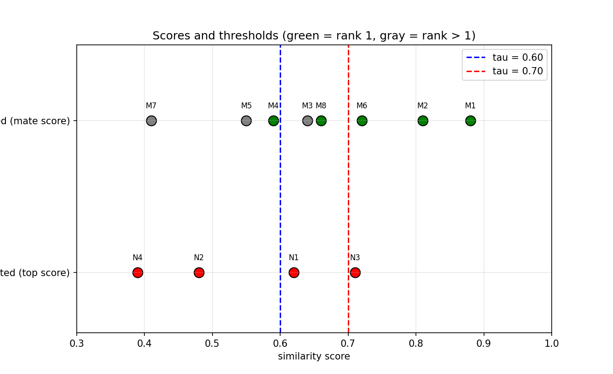
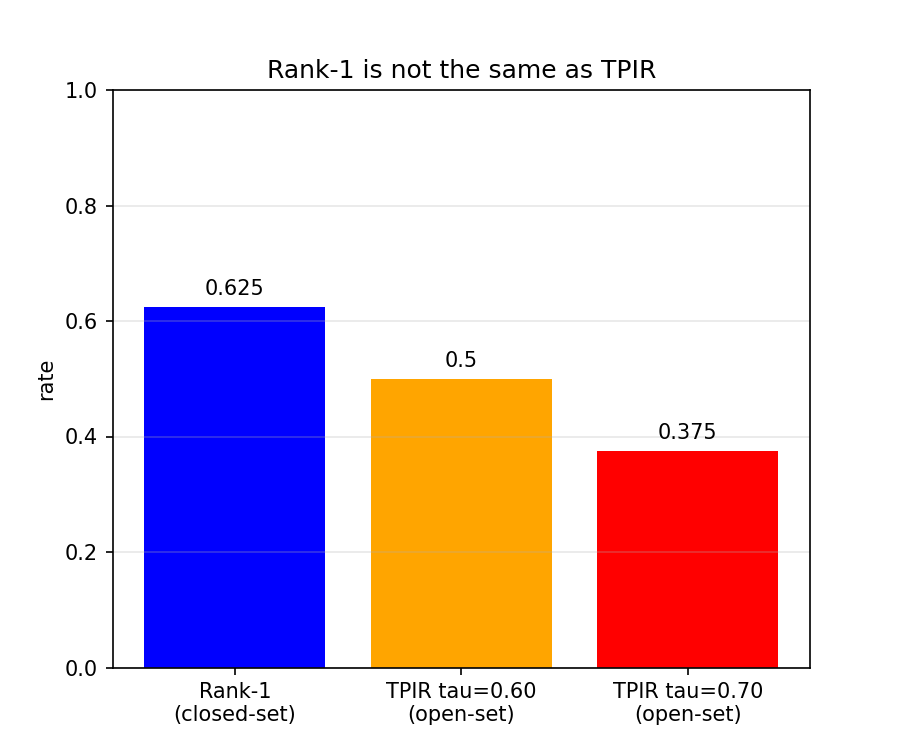
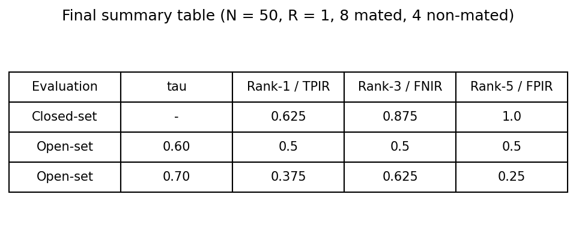

# Evaluation of a Biometric Identification System

Short report and code for the assignment *Evaluation of a biometric identification system*, in two settings: **closed-set** and **open-set** identification.

## Project structure

```
identification_eval/
├── main.py                 # menu: choose which part to run
├── data.py                 # the data and the functions that compute the metrics
├── part1_closed_set.py     # Questions 1-6: Rank-k and CMC curve
├── part2_open_set.py       # Questions 7-14: TPIR, FNIR, FPIR, operating points
├── part3_summary.py        # Questions 15-19: threshold choice, Rank-1 vs TPIR, summary
├── README.md               # this report
└── plots/                  # created automatically (part1, part2, part3)
```

## How to run

```bash
pip install matplotlib
cd identification_eval
python main.py
```

Choose `1`, `2`, `3` or `all` in the menu (`q` to quit).

---

## Data

- Gallery size **N = 50** enrolled identities
- 8 mated searches (rank r of the correct identity, mate score):
  M1 (1, 0.88), M2 (1, 0.81), M3 (2, 0.64), M4 (1, 0.59), M5 (3, 0.55), M6 (1, 0.72), M7 (5, 0.41), M8 (1, 0.66)
- 4 non-mated searches (highest gallery score):
  N1 0.62, N2 0.48, N3 0.71, N4 0.39
- Open-set rule: a mated search is identified if **rank <= R and score >= tau**. A non-mated search is a false positive if its top score is **>= tau**.

---

# Part 1. Closed-set identification

### 1. Which searches are used?

Only the **8 mated searches**. Closed-set identification assumes the correct person is in the gallery, so the question is "at which rank is the correct person?". The 4 non-mated searches have no correct identity, so they have no rank and cannot be used.

### 2-4. Rank-k identification rates

Rank-k rate = (mated searches with the correct identity in the first k) / 8

| k | Searches found within the first k | Rank-k rate |
|---|---|---|
| 1 | M1, M2, M4, M6, M8 (5) | **0.625** |
| 2 | the 5 above + M3 (6) | 0.750 |
| 3 | the 6 above + M5 (7) | **0.875** |
| 4 | still 7 | 0.875 |
| 5 | all 8 (M7 is at rank 5) | **1.000** |

### 5. CMC curve



The CMC curve never goes down, because each new rank includes the previous ones. It starts at 0.625 and reaches 1.0 at rank 5.

### 6. Meaning of Rank-1, Rank-3 and Rank-5

- **Rank-1 = 62.5%:** in 62.5% of the searches, the correct person is the **best candidate** of the ranked list.
- **Rank-3 = 87.5%:** in 87.5% of the searches, the correct person is **somewhere in the 3 best candidates**.
- **Rank-5 = 100%:** in all searches, the correct person is **somewhere in the 5 best candidates**.

Rank-k does **not** mean that the system returns k identities as its final decision. It only measures **where the correct identity appears in the ranked list**. It tells us how good the ranking is. For example, a human operator who reviews the top 5 candidates would find the right person every time here, but the system alone would get only 62.5% right at rank 1.

---

# Part 2. Open-set identification (R = 1, tau = 0.60)

### 7. Each mated search

| Search | Rank | Score | Rank <= 1 ? | Score >= 0.60 ? | Result |
|---|---|---|---|---|---|
| M1 | 1 | 0.88 | yes | yes | **identified** |
| M2 | 1 | 0.81 | yes | yes | **identified** |
| M3 | 2 | 0.64 | no | yes | missed (rank) |
| M4 | 1 | 0.59 | yes | no | missed (score) |
| M5 | 3 | 0.55 | no | no | missed |
| M6 | 1 | 0.72 | yes | yes | **identified** |
| M7 | 5 | 0.41 | no | no | missed |
| M8 | 1 | 0.66 | yes | yes | **identified** |

### 8. TPIR

TPIR = 4 / 8 = **0.50**. Half of the enrolled people who are searched are correctly identified.

### 9. FNIR

FNIR = 4 / 8 = **0.50**. Check: FNIR = 1 - TPIR = 1 - 0.5 = 0.5. This holds because each mated search is either identified or missed, with nothing in between.

---

# Part 3. Non-mated searches (tau = 0.60)

### 10. Each non-mated search

| Search | Top score | >= 0.60 ? | Result |
|---|---|---|---|
| N1 | 0.62 | yes | **false positive** (returns an enrolled identity) |
| N2 | 0.48 | no | correctly rejected |
| N3 | 0.71 | yes | **false positive** |
| N4 | 0.39 | no | correctly rejected |

### 11. FPIR

FPIR = 2 / 4 = **0.50**. Half of the unknown people are wrongly matched to someone enrolled. This is dangerous in a security system.

---

# Part 4. Effect of the threshold

### 12. Results at tau = 0.70 (R = 1)

- Mated: M1 (0.88), M2 (0.81) and M6 (0.72) are identified. M8 (rank 1, 0.66) is now **missed** because 0.66 < 0.70. M4, M3, M5 and M7 are missed as before.
- Non-mated: only N3 (0.71) is a false positive. N1 (0.62) is now rejected.

| Metric | Value |
|---|---|
| TPIR | 3 / 8 = **0.375** |
| FNIR | 5 / 8 = **0.625** |
| FPIR | 1 / 4 = **0.25** |

### 13. Comparison tau = 0.60 vs tau = 0.70

| Metric | tau = 0.60 | tau = 0.70 | Change |
|---|---|---|---|
| TPIR | 0.500 | 0.375 | goes **down** |
| FNIR | 0.500 | 0.625 | goes **up** |
| FPIR | 0.500 | 0.250 | goes **down** |

- **TPIR goes down:** a higher threshold asks for more evidence, so some correct identities with a lower score (like M8) are no longer accepted.
- **FNIR goes up:** it is exactly 1 - TPIR, so more enrolled people are missed.
- **FPIR goes down:** unknown people need a higher score to be accepted, so fewer are wrongly matched (N1 is now rejected).

**Trade-off:** a higher threshold gives more security (fewer unknown people returned as enrolled) but less recognition (more enrolled people missed). We cannot improve both with the threshold alone.

---

# Part 5. Operating points

### 14. (FPIR, FNIR) points



| tau | FPIR (x) | FNIR (y) |
|---|---|---|
| 0.60 | 0.50 | 0.50 |
| 0.70 | 0.25 | 0.625 |

Going from tau = 0.60 to tau = 0.70 moves the point to the **left** (FPIR falls from 0.50 to 0.25) and **up** (FNIR rises from 0.50 to 0.625). The system becomes safer against unknown people but misses more enrolled people. Both points are still far from the ideal corner (0, 0), which shows that the system has a limited quality.



---

# Part 6. Choosing a threshold

### 15. Recommendations

| Application | Threshold | TPIR | FNIR | FPIR |
|---|---|---|---|---|
| **A. Security watchlist** | **0.70** | 0.375 | 0.625 | 0.25 |
| **B. Staff identification** | **0.60** | 0.500 | 0.500 | 0.50 |

**A. Security watchlist: tau = 0.70.** The priority is to avoid returning an enrolled identity for an unknown person. At 0.70, FPIR is 0.25, half of the 0.50 at tau = 0.60. We accept a lower TPIR (0.375) and a higher FNIR (0.625) as the price. A missed watchlist person can still be found by other means, and a false alarm has a real cost.

**B. Staff identification: tau = 0.60.** The priority is to recognize employees conveniently. At 0.60, TPIR is higher (0.50 against 0.375) and FNIR is lower (0.50 against 0.625), so more employees are recognized. The weakness is FPIR = 0.50, so this system should not control sensitive access on its own. Unknown people must be handled by another control (a badge, a guard). With so little data, neither threshold is really good, and a better matcher is needed.

---

# Part 7. Rank-1 vs TPIR

### 16. Comparison

| | Value |
|---|---|
| Closed-set Rank-1 | 0.625 |
| Open-set TPIR at tau = 0.60 | 0.500 |

They are not the same because they answer different questions:

- **Ranking:** Rank-1 only checks that the correct person is **first** in the list. TPIR also requires rank <= R, but it adds a second condition.
- **Threshold:** TPIR also requires the mate score to be **>= tau**. Rank-1 has no threshold, so a first-place candidate with a weak score still counts as a success.
- **Rejection:** an open-set system must be able to say "unknown". When the best score is too low, it rejects the probe. A mated search that is rejected counts as a miss for TPIR, but it was still a success for Rank-1.

In this experiment, the difference is **M4**: it is ranked first (rank 1) but its score is 0.59, below 0.60. So it counts for Rank-1 (5/8 = 0.625) but not for TPIR (4/8 = 0.50).



### 17. Why can a correct identity be ranked first and still fail?

Because in open-set identification, **being first is not enough**: the system must also be confident. If the best candidate has a score below the threshold, the system concludes that there is not enough evidence and rejects the probe as unknown. M4 is the example (rank 1, score 0.59 < 0.60). At tau = 0.70, M8 is another example (rank 1, score 0.66 < 0.70). The threshold protects against false positives from unknown people, but it also rejects some correct but weak matches.

---

# Part 8. Reporting

### 18. Why report the operating conditions?

An open-set result has no meaning alone. The values of TPIR, FNIR and FPIR change with the settings: a different threshold or rank cutoff gives different rates, as shown above (FPIR goes from 0.50 to 0.25 when tau goes from 0.60 to 0.70). The gallery size and the number of searches matter too: a bigger gallery has more chances for a wrong high score, and few searches make the rates unreliable. To allow others to understand and reproduce the result, always state:

- gallery size **N = 50**
- rank cutoff **R = 1**
- threshold **tau = 0.60** (and 0.70)
- number of mated searches: **8**
- number of non-mated searches: **4**

With only 8 and 4 searches, each search changes a rate by 12.5% and 25%, so these numbers show the method but are not statistically reliable.

### 19. Final summary table

| Evaluation | tau | Metric | Value |
|---|---|---|---|
| Closed-set | - | Rank-1 | 0.625 |
| Closed-set | - | Rank-3 | 0.875 |
| Closed-set | - | Rank-5 | 1.000 |
| Open-set | 0.60 | TPIR | 0.500 |
| Open-set | 0.60 | FNIR | 0.500 |
| Open-set | 0.60 | FPIR | 0.500 |
| Open-set | 0.70 | TPIR | 0.375 |
| Open-set | 0.70 | FNIR | 0.625 |
| Open-set | 0.70 | FPIR | 0.250 |

Conditions: N = 50, R = 1, 8 mated searches, 4 non-mated searches.



---

## Short interpretation

- The **ranking is good**: the correct person is in the top 5 every time and in the top 3 for 87.5% of the searches (closed-set).
- The **open-set decision is harder**: at R = 1, a correct identity must be first **and** have a high enough score, so TPIR (0.50) is lower than Rank-1 (0.625).
- Raising the threshold from 0.60 to 0.70 **lowers FPIR** (0.50 to 0.25) but **raises FNIR** (0.50 to 0.625). This is the security-versus-recognition trade-off.
- The right threshold depends on the application: 0.70 for a watchlist, 0.60 for staff identification.
- Always report N, R, tau and the number of searches, because the results depend on them.
